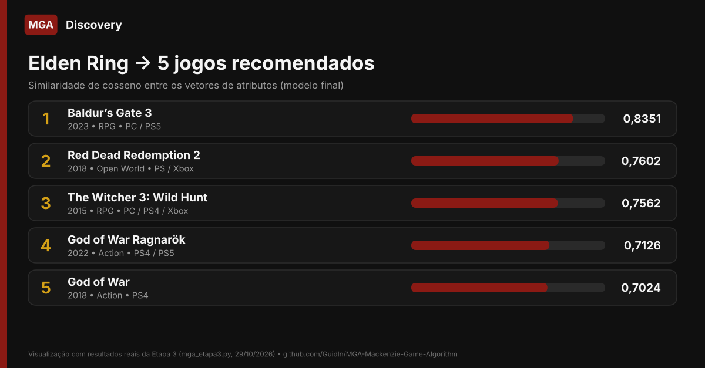
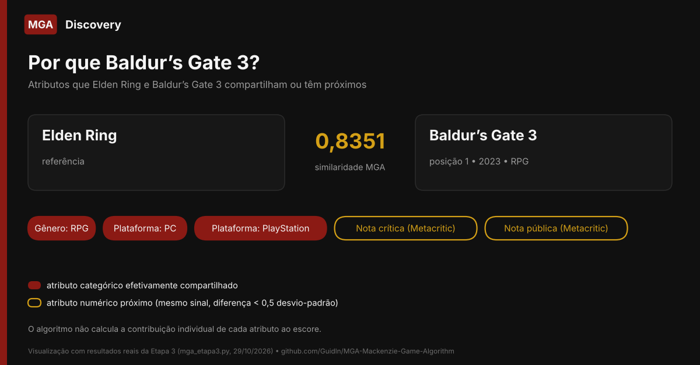
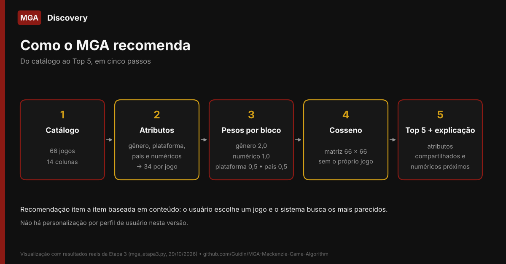
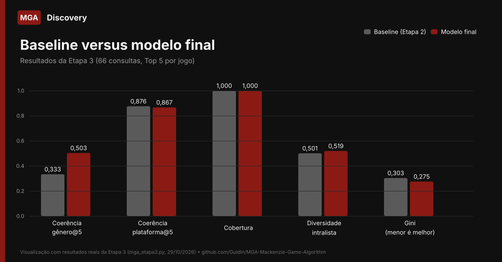

<div align="center">

# 🎮 MGA Discovery
### Mackenzie Game Algorithm

**Sistema de recomendação de jogos digitais baseado em conteúdo**
Projeto Aplicado III • Universidade Presbiteriana Mackenzie


</div>

---

## 📖 Sobre o projeto

O **MGA** recomenda jogos parecidos com um jogo escolhido pelo usuário e **explica cada indicação** pelos atributos que os dois títulos compartilham. A base reúne os **66 jogos indicados à categoria Game of the Year do The Game Awards (2014–2024)**.

Cada jogo vira um vetor de **34 atributos**: gênero, plataforma, país de maior volume de vendas, ano, quantidade de prêmios, vendas, notas do Metacritic (público e crítica) e jogadores que concluíram o jogo. A semelhança entre dois jogos é a **similaridade de cosseno** entre seus vetores.

> 💡 A recomendação é **item a item**: parte de um jogo de referência, sem perfil individual de usuário.

## 👥 Equipe

| | |
|---|---|
| 👩‍💻 | Bruna Graciano |
| 👨‍💻 | Guilherme Marques Gomes dos Santos |
| 👨‍💻 | Guilherme Barros Toledo Batista |
| 👨‍💻 | Lincoln Cavalcanti Bertoldo Alves |

## 🎬 Vídeos

### 📺 Vídeo de apresentação do projeto (5 minutos)

> 🔗 **Link do YouTube:** _cole aqui o link do vídeo_

<!-- Para exibir a miniatura clicável, troque SEU_LINK e ID_DO_VIDEO e remova os comentários:
[](SEU_LINK)
-->

### 🤝 Vídeo da aplicação do projeto na comunidade

> 🔗 **Link do YouTube:** _cole aqui o link do vídeo_

<!-- [](SEU_LINK) -->

## 🖼️ O sistema

| Recomendações | Explicação |
|---|---|
|  |  |

> As imagens acima são visualizações com os resultados reais da Etapa 3 (Elden Ring → Baldur's Gate 3, similaridade 0,8351).

## ✨ Funcionalidades

- 🏠 **Início**: busca, jogos em destaque e indicadores gerais
- 🗂️ **Catálogo**: os 66 jogos, com filtros por gênero, plataforma e ano, busca e ordenação
- 🎯 **Recomendações MGA**: Top 5 com posição e similaridade
- 🔍 **Por que este jogo?**: atributos categóricos compartilhados e numéricos próximos
- ⚔️ **MGA Versus**: comparação lado a lado de dois jogos
- 📊 **MGA Insights**: indicadores, gráficos e limitações do modelo

## 🧠 Como funciona



1. **Atributos:** codificação multi-hot (gênero e plataforma), one-hot (país), `log1p` e padronização nas variáveis numéricas, mediana com indicador de ausência.
2. **Pesos por bloco:** gênero 2,0 • numérico 1,0 • plataforma 0,5 • país 0,5, cada bloco dividido por √(nº de colunas).
3. **Cosseno:** matriz 66 × 66, sem o próprio jogo no ranking.
4. **Explicação:** função `explain()` do pipeline original.

## 📈 Resultados (Etapa 3)

| Indicador | Baseline | Modelo final |
|---|:-:|:-:|
| 🎭 Coerência de gênero@5 | 0,333 | **0,503** |
| 🖥️ Coerência de plataforma@5 | 0,876 | 0,867 |
| 📚 Cobertura do catálogo | 100% | 100% |
| ⚖️ Gini | 0,303 | **0,275** |
| 🌈 Diversidade intralista | 0,501 | **0,519** |
| ✅ Validade das explicações | 27,8% | **100%** (990 de 990) |



Sensibilidade a 54 combinações de pesos: Jaccard@5 médio de 0,62. Com ruído gaussiano (σ = 0,05): 0,69.

> ⚠️ São indicadores de **coerência, cobertura, diversidade e estabilidade**. Não medem acurácia preditiva nem satisfação de usuários, e a similaridade não é probabilidade de preferência.

## 📦 Entregas da Etapa 4

| Entrega | Arquivo ou link |
|---|---|
| 🗒️ Documentação do projeto (Canvas) | [docs/entrega/Canvas_Projeto_MGA.pdf](docs/entrega/Canvas_Projeto_MGA.pdf) (editável: [.docx](docs/entrega/Canvas_Projeto_MGA.docx)) |
| 📄 Relatório final e anexos | [docs/entrega/MGA_Documento_Unico_Etapa4.pdf](docs/entrega/MGA_Documento_Unico_Etapa4.pdf) |
| 📊 Planilha de resultados | [docs/entrega/MGA_Resultados_Etapa4.xlsx](docs/entrega/MGA_Resultados_Etapa4.xlsx) |
| 💻 Artefatos de software | Este repositório |
| 📺 Vídeo de apresentação (5 minutos) | _link na seção Vídeos_ |
| 🤝 Vídeo da aplicação na comunidade | _link na seção Vídeos_ |

## 🚀 Como rodar

Requisitos: **Python 3.11+** e **Node.js 20+**.

1. Coloque a planilha da base (com a aba `Base_Jogos`) em `backend/data/`. Qualquer nome `.xlsx` serve.
2. Rode o script:

```bash
./run.sh          # Linux/macOS
run.bat           # Windows
```

Abra **http://localhost:8000**. A documentação da API fica em `/docs`.

<details>
<summary>🔧 Passo a passo manual e solução de problemas</summary>

```bash
python -m venv .venv && source .venv/bin/activate     # Windows: .venv\Scripts\activate
pip install -r backend/requirements.txt
cd frontend && npm install && npm run build && cd ..
uvicorn app.main:app --app-dir backend --port 8000
```

Modo desenvolvimento: `uvicorn app.main:app --reload --app-dir backend` e, em outro terminal, `cd frontend && npm run dev` (http://localhost:5173).

Se algo falhar, rode `python scripts/check_setup.py`: ele mostra o que falta (versão do Python, pacotes, base, interface compilada). `http://localhost:8000/api/health` indica se a base foi carregada.

🐳 Com Docker: `docker compose up --build` (interface em http://localhost:8080).

☁️ Publicação: o `Dockerfile` e o `render.yaml` na raiz publicam API e interface em um único endereço no Render.

</details>

## 🔌 API

`GET /api/health` • `GET /api/games` • `GET /api/games/search?q=` • `GET /api/games/{id}` • `POST /api/recommendations` • `POST /api/explanations` • `POST /api/compare` • `GET /api/insights` • `GET /api/insights/sensitivity`

## 🗂️ Estrutura

```
backend/    app (FastAPI), algorithm (pipeline original e métricas), data
frontend/   React + TypeScript + Vite + Tailwind
docs/       Canvas, relatório, metodologia, arquitetura e diagramas, testes, entrega (PDF e DOCX)
artifacts/  figuras, imagens e relatório da Etapa 3
tests/      pytest
```

O algoritmo é o `mga_pipeline.py` original; a única alteração foi o caminho da base, que agora vem de `MGA_DATA_PATH` ou de `backend/data/`.

## 🔭 Limitações e próximos passos

- Base de 66 jogos, com viés de seleção (indicados a um prêmio) e um gênero por jogo.
- Listas sensíveis aos pesos dos blocos, definidos a priori.
- Sem julgamentos de relevância, não há Precision@K, Recall@K nem NDCG@K.

**Próximos passos:** ampliar o catálogo, incluir descrições textuais com TF-IDF, coletar julgamentos de relevância, validar os pesos, avaliar com usuários e estudar abordagens híbridas.

---

<div align="center">

🎓 **Projeto Aplicado III** • Universidade Presbiteriana Mackenzie • 2026

</div>
