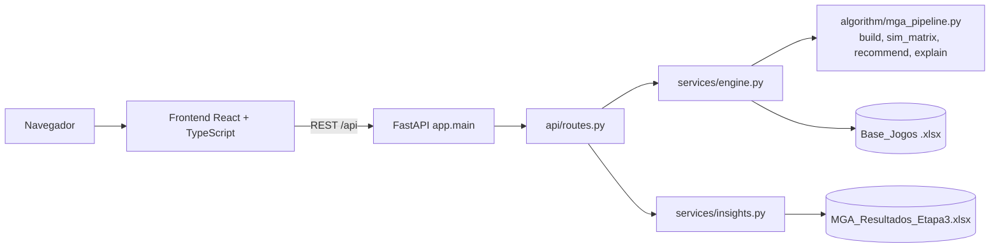
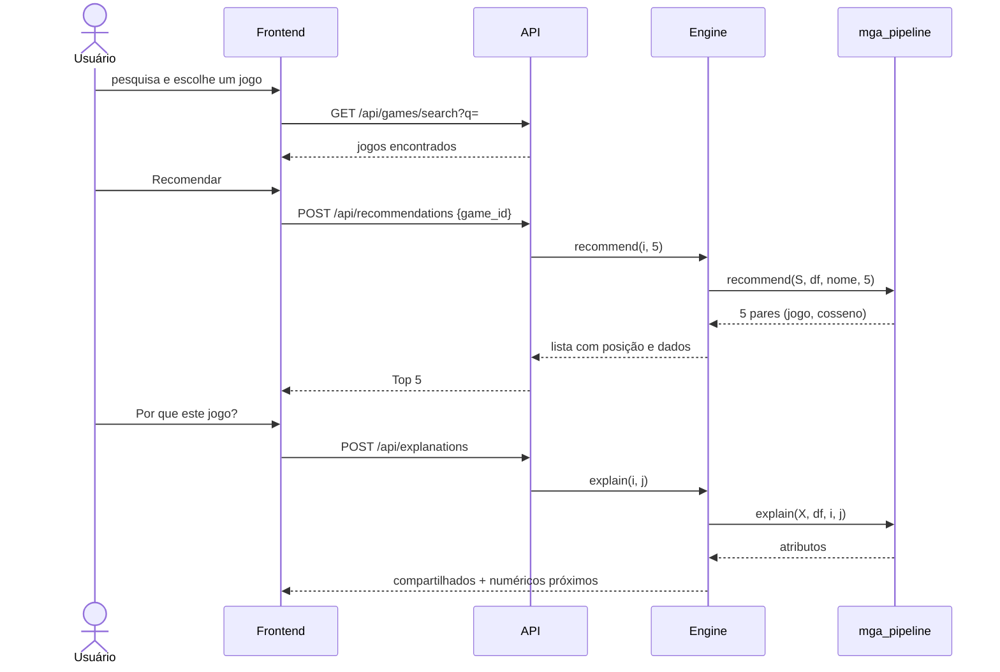
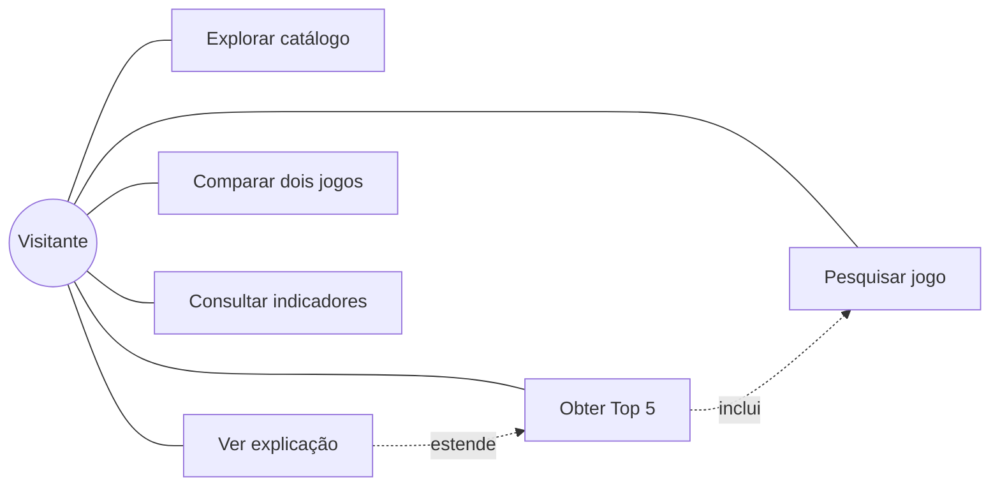
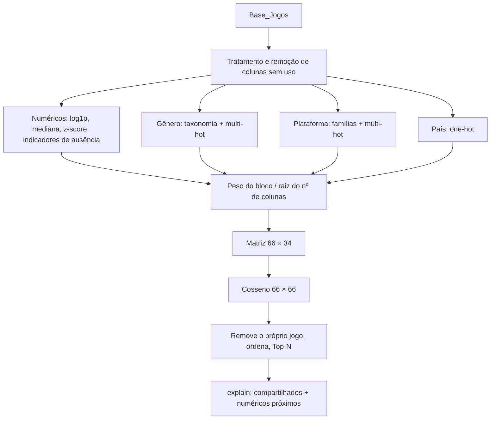
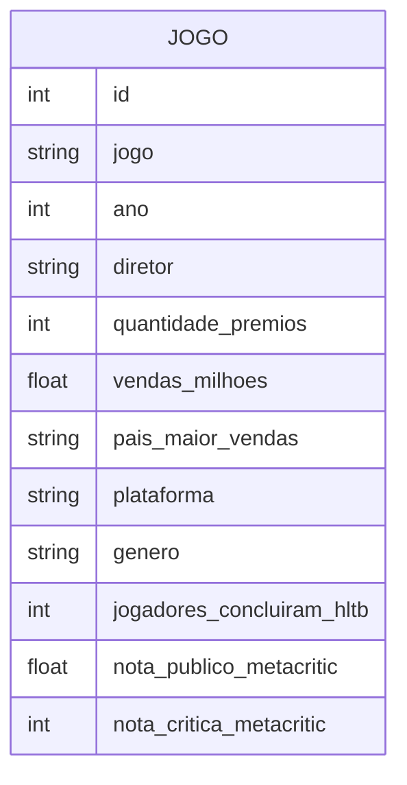

# Arquitetura

Os diagramas abaixo usam Mermaid (renderizado pelo GitHub) e descrevem o que está implementado.

## Componentes

A matriz X (66 × 34) e a matriz de similaridade S (66 × 66) são calculadas uma vez, na inicialização (`lifespan`). Os endpoints só consultam essas matrizes.

## Sequência: recomendação com explicação

## Casos de uso

## Fluxo do algoritmo

## Modelo de dados (catálogo)

O `id` é a posição da linha na aba `Base_Jogos`. A coluna `cover_url` é opcional e vem de `backend/data/covers.json`.

## Endpoints
| Método | Rota | Função |
|---|---|---|
| GET | /api/health | Estado da API e da base |
| GET | /api/games | Catálogo completo |
| GET | /api/games/search?q= | Busca por nome |
| GET | /api/games/{id} | Um jogo |
| POST | /api/recommendations | Top-k de um jogo (k de 1 a 10, padrão 5) |
| POST | /api/explanations | `explain()` para um par de jogos |
| POST | /api/compare | Comparação de dois jogos |
| GET | /api/insights | Indicadores (lidos da planilha de resultados) |
| GET | /api/insights/sensitivity | 54 combinações de pesos |

A documentação Swagger fica em `/docs`. Erros: 404 (jogo inexistente), 422 (validação), 503 (base ou planilha ausente).
