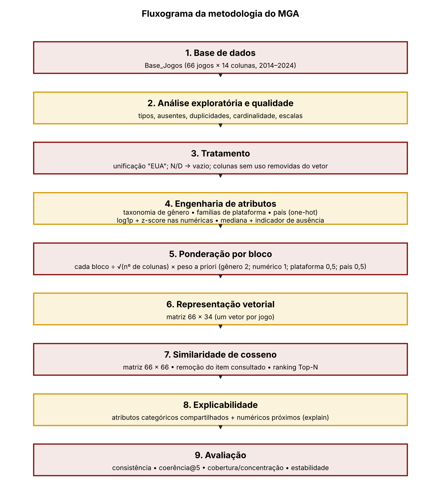
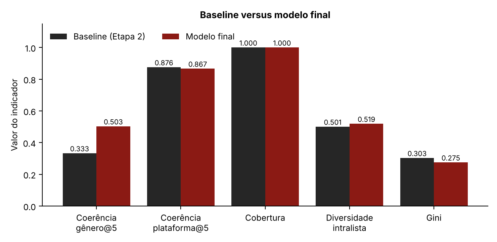
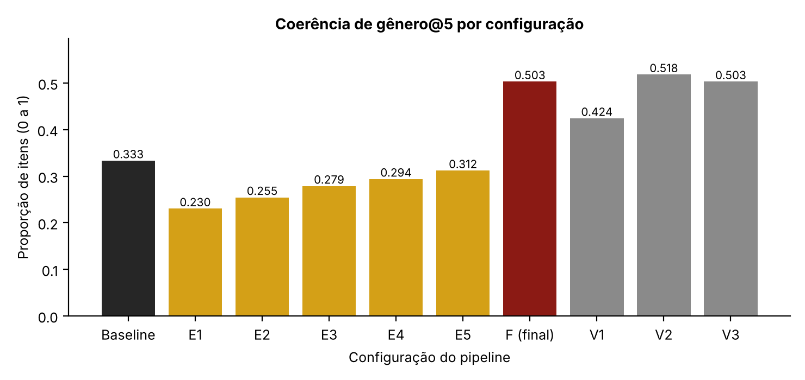
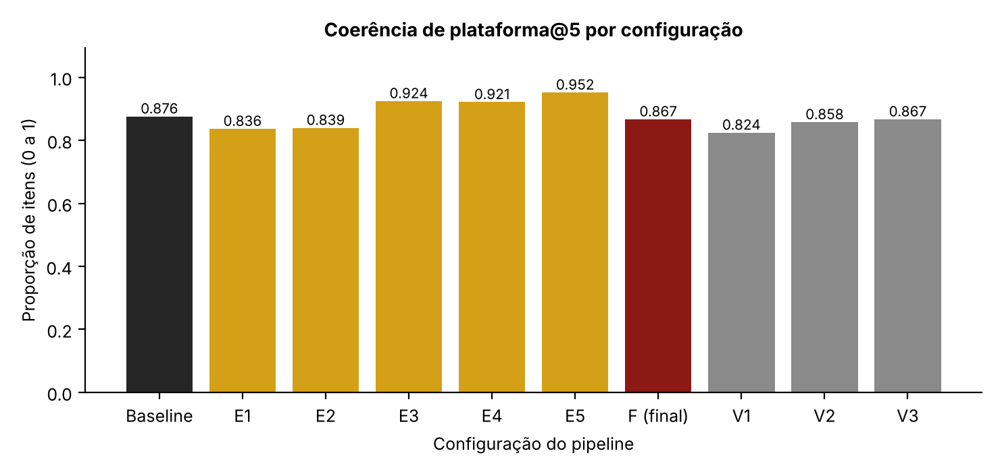
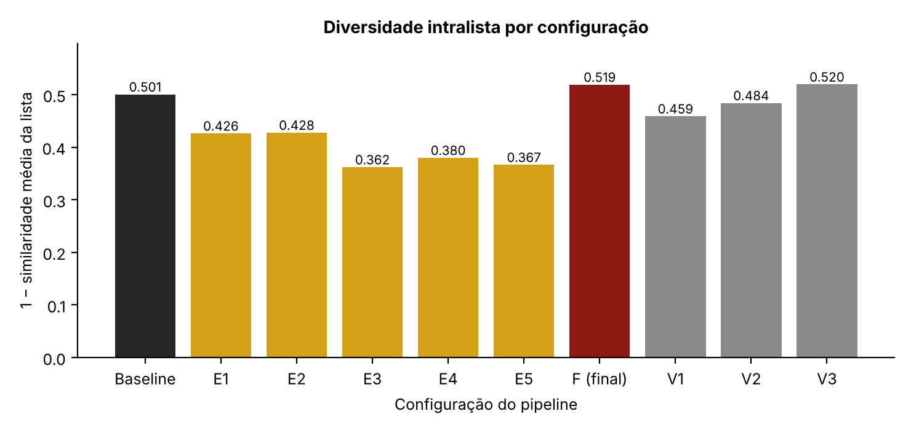
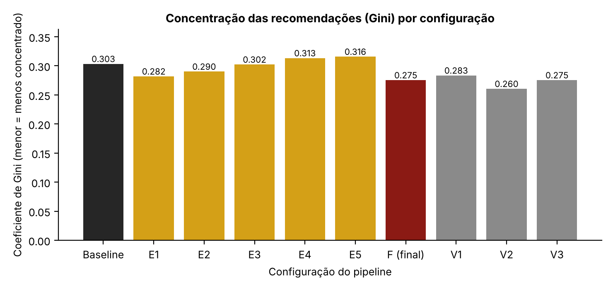
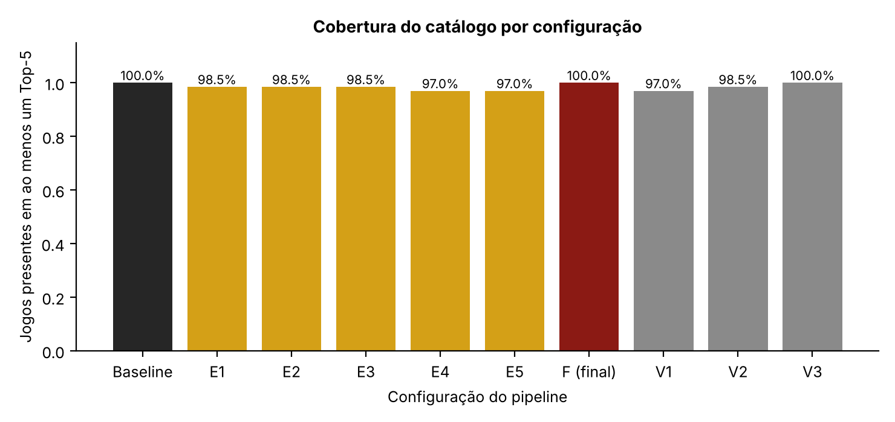
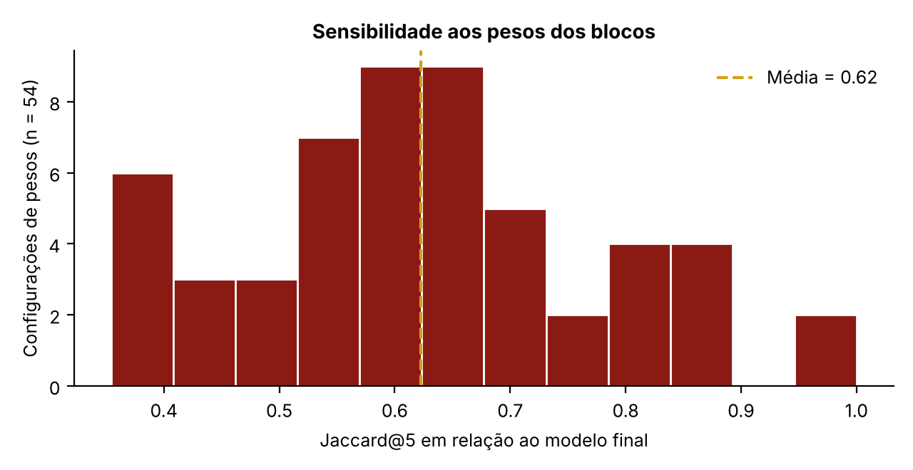
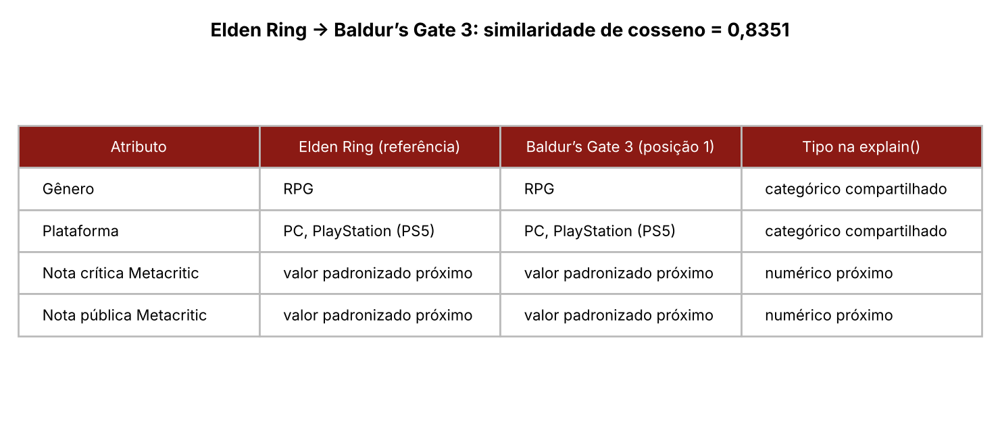

# MGA – Mackenzie Game Algorithm
## Projeto Aplicado III – Etapa 4: Resultados, Conclusão e Trabalhos Futuros

> Este arquivo contém as seções 8 e 9 do relatório. Elas continuam o documento da Etapa 3 (`artifacts/reports/MGA_Projeto_Aplicado_III_Etapa_3.pdf`), cujas seções 1 a 7 permanecem como estão. Ao montar o arquivo final, estas seções entram depois da seção 6 (Conclusão da Etapa 3, que passa a ser a seção 9) e antes das Referências. A numeração das figuras continua a partir da Figura 11.
> Todos os valores foram tirados do relatório da Etapa 3 e da planilha `MGA_Resultados_Etapa3.xlsx` (execução de 29/10/2026). Nenhum número foi recalculado ou ajustado.

---

## 8 RESULTADOS

### 8.1 Organização dos resultados

Os resultados do projeto estão em três grupos. O primeiro é o diagnóstico do baseline da Etapa 2, que apontou seis problemas (Quadro 8 do relatório). O segundo é a reavaliação do pipeline ajustado: uma ablação com dez configurações (baseline, E1 a E5, modelo final F e variantes V1 a V3), 54 combinações de pesos na análise de sensibilidade e testes de estabilidade com ruído e com outra métrica de similaridade. O terceiro é a aplicação MGA Discovery, que expõe o mesmo pipeline por uma API e por uma interface web.

Todos os indicadores foram calculados sobre as 66 consultas possíveis (cada jogo como referência, N = 5). A matriz final tem 66 jogos e 34 atributos: 8 numéricos, 17 de gênero, 5 de plataforma e 4 de país.

### 8.2 Desempenho geral do modelo

O modelo final usa pesos de bloco definidos antes da avaliação (gênero 2,0; numérico 1,0; plataforma 0,5; país 0,5). As verificações técnicas de consistência foram todas atendidas: o jogo consultado não aparece no próprio ranking, os escores ficam dentro de [−1, 1] (mínimo de −0,5966 e máximo fora da diagonal de 0,9657) e o ranking é reproduzível.

**Tabela 7 – Indicadores do modelo final (66 consultas, N = 5)**

| Indicador | Modelo final |
|---|---|
| Coerência de gênero@5 | 0,503 |
| Coerência de plataforma@5 | 0,867 |
| Cobertura do catálogo | 100% |
| Máximo de listas por jogo | 13 |
| Gini das recomendações | 0,275 |
| Diversidade intralista | 0,519 |
| Validade das explicações | 100% (990 de 990) |
| Jaccard@5 com ruído gaussiano (σ = 0,05) | 0,69 |
| Jaccard@5 com similaridade euclidiana | 0,64 |

Fonte: elaboração própria, planilha MGA_Resultados_Etapa3.xlsx (abas Ablacao e Consistencia).

Esses indicadores descrevem coerência, cobertura, diversidade e estabilidade das listas. Eles não medem acurácia preditiva nem satisfação de usuários, e a similaridade de cosseno não deve ser lida como probabilidade de preferência.

**Figura 11 – Fluxograma da metodologia do MGA (versão atualizada).**

### 8.3 Comparação entre baseline e modelo final

**Tabela 8 – Comparação entre o baseline (Etapa 2) e o modelo final**

| Indicador | Baseline (Etapa 2) | Modelo final | Variação |
|---|---|---|---|
| Atributos | 42 | 34 | −8 |
| Coerência de gênero@5 | 0,333 | 0,503 | +0,170 |
| Coerência de plataforma@5 | 0,876 | 0,867 | −0,009 |
| Cobertura | 100% | 100% | 0 |
| Máximo de listas por jogo | 14 | 13 | −1 |
| Gini | 0,303 | 0,275 | −0,028 |
| Diferença média de ano (anos) | 1,88 | 2,06 | +0,18 |
| Diversidade intralista | 0,501 | 0,519 | +0,018 |
| Validade das explicações | 27,8% | 100% | +72,2 p.p. |

Fonte: elaboração própria, saída do script mga_etapa3.py (execução de 29/10/2026).

**Figura 12 – Indicadores do baseline e do modelo final.**

Um ponto precisa ficar claro. Os passos E1 a E5, aplicados sozinhos, não melhoraram a coerência de gênero: ela caiu de 0,333 para 0,230 em E1 e subiu depois até 0,312 em E5, ainda abaixo do baseline. O ganho para 0,503 aparece só com a ponderação por bloco (F). Como o indicador favorece modelos que priorizam gênero, o resultado mostra mais coerência com o descritor escolhido, não um ganho de qualidade comprovado.

**Figura 13 – Coerência de gênero@5 por configuração.**

**Figura 14 – Coerência de plataforma@5 por configuração.**

**Figura 15 – Diversidade intralista por configuração.**

**Figura 16 – Gini das frequências de recomendação por configuração.**

**Figura 17 – Cobertura do catálogo por configuração.** Nas configurações E1 a E5 a cobertura ficou entre 97,0% e 98,5%; só o baseline e o modelo final chegam a 100%.

**Figura 18 – Estabilidade dos Top-5 frente a 54 combinações de pesos.** Jaccard@5 médio de 0,62 e mínimo de 0,35; coerência de gênero@5 entre 0,212 e 0,779.

**Figura 19 – Atributos que explicam a recomendação de Baldur’s Gate 3 para Elden Ring (escore 0,8351).**

### 8.4 Análise das técnicas utilizadas

**Content-Based Filtering.** Era a escolha compatível com a base, que descreve os jogos mas não tem avaliações, compras ou horas jogadas. Permite recomendar a partir de um único jogo e justificar cada resultado pelos atributos. Em contrapartida, o resultado depende só da qualidade dos atributos disponíveis, e o modelo não personaliza nada.

**Similaridade de cosseno.** Compara o padrão dos vetores e é simples de calcular e explicar. Na base de 66 jogos, muitos escores ficam próximos e pequenas perturbações trocam as últimas posições do Top-5. A troca pela similaridade baseada em distância euclidiana manteve só parte das listas (Jaccard@5 de 0,64), o que mostra que a escolha da métrica também afeta o resultado.

**Engenharia de atributos por blocos.** A divisão em blocos com normalização por 1/√(número de colunas) evita que o bloco com mais colunas domine o cosseno. Sozinha (E1), ela reduziu a coerência de gênero; uma explicação provável, que não foi testada separadamente, é que o bloco de gênero passou a ter o mesmo peso total do numérico. O ganho só aparece quando a equalização é combinada com pesos explícitos.

**Taxonomia de gêneros.** Reduziu a fragmentação (de 21 rótulos, 12 deles únicos, para 17 colunas) sem criar categorias externas. O efeito isolado em E2 foi pequeno (0,230 para 0,255). A limitação é que cada jogo continua com um único gênero de origem.

**Famílias de plataforma.** Resolveram a multivalência e a ambiguidade entre PS, PS4 e PS5. A coerência de plataforma subiu em E3 (0,924), mas voltou a 0,867 no modelo final, em que o bloco tem peso 0,5. Os rótulos “Consoles” e “Multi” seguem como hipótese de mapeamento.

**Transformação logarítmica.** Atenua a assimetria de vendas e HLTB. O efeito isolado em E4 foi pequeno e misto (coerência de gênero de 0,279 para 0,294; Gini de 0,302 para 0,313). A justificativa é estatística, não de ganho nos indicadores.

**Tratamento de dados ausentes.** Mediana mais indicador de ausência mantém todos os 66 jogos e registra a falta de informação. O indicador (E5) elevou a coerência de gênero a 0,312, mas o máximo de listas por jogo foi a 15, o maior da ablação. Remover a variável HLTB (V1) reduziu a coerência de gênero para 0,424, o que sustenta a decisão de mantê-la.

**Ponderação dos blocos.** É a técnica de maior efeito (0,312 para 0,503) e também a mais frágil: os pesos foram definidos a priori e a sensibilidade mostra que as listas mudam bastante com eles.

**Explicabilidade.** A explicação passou de 27,8% para 100% de atributos realmente compartilhados (990 de 990). A função lista atributos compartilhados e numéricos próximos; ela não calcula a contribuição de cada atributo ao escore, e a interface não apresenta nenhum valor desse tipo. O fluxograma da Etapa 3 descrevia esse passo como “atributos com maior contribuição ao cosseno”; a Figura 11 corrige o texto para refletir o que o código faz.

### 8.5 Pontos positivos

- Explicações coerentes: 100% dos atributos citados são de fato compartilhados.
- Aumento da coerência de gênero@5 de 0,333 para 0,503, com cobertura de 100% do catálogo.
- Menor concentração das listas (Gini de 0,303 para 0,275) e listas um pouco mais diversas (0,501 para 0,519).
- Modelo determinístico e reprodutível, com verificações técnicas atendidas.
- Decisões de projeto sustentadas pela ablação: o ano foi mantido (sem ele a diferença média de ano vai a 3,73) e o diretor foi excluído (não altera os indicadores e leva a matriz a 91 atributos).
- Resultado fácil de demonstrar: o pipeline original sustenta a API e a interface sem reimplementação.

### 8.6 Pontos negativos e limitações

- Base de 66 jogos, formada por indicados a um prêmio. Não representa o mercado e limita a diversidade.
- Um único gênero por jogo e muitos gêneros raros: jogos como Hades (Roguelike) têm poucos vizinhos legítimos. Na lista de Hades, só Balatro compartilha gênero.
- Coerência de gênero@5 de 0,503 significa que cerca de metade dos itens recomendados não compartilha gênero com a referência. Por exemplo, para The Last of Us Part II, Baldur’s Gate 3 aparece em segundo sem gênero em comum.
- Pequenas perdas em coerência de plataforma (0,876 para 0,867) e em proximidade temporal (1,88 para 2,06 anos).
- Sensibilidade alta aos pesos (Jaccard médio de 0,62 e mínimo de 0,35; coerência de gênero de 0,212 a 0,779) e estabilidade moderada a ruído (0,69).
- O indicador de coerência de gênero favorece o modelo que mais pesa o gênero, o que enfraquece a comparação com o baseline.
- Ausência de julgamentos de relevância: não há Precision@K, Recall@K nem NDCG@K, e nenhuma conclusão sobre acurácia ou satisfação é possível.
- Os rótulos de plataforma “Consoles” e “Multi” dependem de hipótese.

### 8.7 Discussão crítica

As decisões metodológicas trocam uma coisa por outra. Dar peso 2,0 ao gênero aumenta a coerência de conteúdo, mas reduz a de plataforma e a proximidade temporal, e deixa o modelo mais sensível à granularidade de uma taxonomia que, em um catálogo de 66 jogos, é pobre. As famílias de plataforma deixam o vetor mais limpo, mas apagam a diferença entre gerações de console. A transformação logarítmica e os indicadores de ausência são corretos do ponto de vista estatístico, porém não produziram, isoladamente, melhoras claras nos indicadores usados.

O dado mais importante da ablação é que o ganho principal vem de uma decisão a priori (os pesos), não de uma técnica de tratamento. Isso é honesto com o método, que não buscou pesos para maximizar um indicador, mas obriga a tratar os pesos atuais como hipótese. Sem julgamentos de relevância, não é possível dizer se o modelo final recomenda melhor ou só recomenda mais por gênero.

A explicabilidade foi o resultado mais claro: ela deixou de apresentar atributos inexistentes e permite ver, por exemplo, que Baldur’s Gate 3 aparece para Elden Ring por gênero (RPG), plataformas (PC e PlayStation) e notas do Metacritic próximas, enquanto o segundo colocado de The Last of Us Part II decorre de plataforma, país e indicadores numéricos.

### 8.8 Resultados da aplicação

A aplicação MGA Discovery é uma camada de acesso ao algoritmo. Os resultados experimentais acima vêm do script `mga_etapa3.py`; a interface não gera resultados novos, só os exibe. Esta distinção vale para toda a seção.

**Arquitetura.** O backend em FastAPI carrega a base e constrói a matriz de atributos e a matriz de similaridade uma única vez, na inicialização, usando o `mga_pipeline.py` original (funções `build`, `sim_matrix`, `recommend` e `explain`). A única alteração no pipeline foi o caminho da base, que agora vem da variável `MGA_DATA_PATH` ou de `backend/data/`. O frontend em React e TypeScript consome os endpoints REST. O código-fonte, a documentação, as figuras e os demais artefatos estão no repositório do projeto: <https://github.com/Guidln/MGA-Mackenzie-Game-Algorithm>. Os diagramas estão em `docs/arquitetura.md`.

**Telas.** Início (busca e destaques), Catálogo (66 jogos, filtros por gênero, plataforma e ano, busca por nome e ordenação), Recomendações (Top 5 com escore e posição), “Por que este jogo?” (atributos categóricos compartilhados separados dos numéricos próximos), Versus (comparação de dois jogos) e Insights (indicadores e gráficos da Etapa 3, com texto explicativo e limitações). As capas são geradas como cartões tipográficos, porque o projeto não possui imagens; o campo `cover_url`, preenchido por `backend/data/covers.json`, permite incluir capas reais.

**Testes.** Os casos de teste automatizados (Anexo D) cobrem a inicialização da API, o carregamento da base, a construção da matriz de atributos, a consulta de jogo existente e inexistente, o Top 5 sem o próprio jogo, as explicações com atributos compartilhados, a comparação entre jogos, os indicadores e a reprodução dos resultados de referência da Etapa 3 (as 15 consultas da planilha e os indicadores do modelo final). Eles rodam com `pytest` e estão configurados para execução automática no GitHub Actions a cada atualização do repositório.

### 8.9 Comparação com trabalhos relacionados

A comparação a seguir é apenas metodológica. Ela se limita aos trabalhos já citados na seção 2 do relatório e ao que ali consta sobre cada um. Não foi feita pesquisa bibliográfica nova nesta etapa. Valores de desempenho não foram comparados, porque bases, métricas e protocolos são diferentes.

**Quadro 9 – Comparação metodológica com trabalhos relacionados**

| Trabalho | Dados | Técnica | Avaliação (conforme descrito no relatório) | Relação com o MGA |
|---|---|---|---|---|
| Farhan et al. (2024) | Descrições textuais de jogos | Content-Based Filtering com TF-IDF e cosseno | Não registrada na seção 2.7 | Mesma família de método. O MGA usa atributos estruturados de tipos mistos, sem texto; TF-IDF é um caminho de evolução. |
| Anti et al. (2025) | Catálogo de 1.000 jogos (gênero, plataforma, classificação, faixa etária) | K-Means combinado com Content-Based Filtering e cosseno | Não registrada na seção 2.7 | Sequência de preparação e cosseno semelhantes. O MGA não agrupa, usa um catálogo bem menor e adiciona ponderação por bloco. |
| Yuen et al. (2023) | Não detalhados no relatório | Aprendizado de máquina e visualização | Não registrada na seção 2.7 | Aproxima-se do MGA na intenção de apoiar a descoberta; o MGA enfatiza a explicação por atributos. |
| Lops, Gemmis e Semeraro (2011) | Revisão da literatura | Recomendação baseada em conteúdo | Revisão | O MGA confirma na prática duas limitações apontadas: dependência da riqueza dos atributos e risco de listas homogêneas. |
| Shani e Gunawardana (2011) | Revisão da literatura | Avaliação de recomendadores | Cobertura, diversidade e estabilidade sem ground truth | Base da avaliação adotada pelo MGA, com a mesma ressalva de que esses indicadores não medem acurácia. |

Fonte: elaboração própria (2026), a partir da seção 2 do relatório.

O ponto de convergência é o uso de Content-Based Filtering e cosseno para jogos. As divergências estão nos dados (estruturados e pequenos, em vez de textuais ou de 1.000 itens), na ponderação explícita de blocos e na ênfase na explicabilidade. Uma comparação quantitativa válida exigiria aplicar os métodos dos outros trabalhos à mesma base, com a mesma métrica, e isso não foi feito.

---

## 9 CONCLUSÃO E TRABALHOS FUTUROS

O objetivo do projeto foi desenvolver um sistema de recomendação de jogos digitais baseado em conteúdo, que ordenasse títulos semelhantes a partir dos atributos de uma base de 66 indicados ao Game of the Year do The Game Awards (2014–2024). O trabalho evoluiu da prova de conceito (Etapa 2) para um pipeline ajustado e avaliado (Etapa 3) e, nesta etapa, para uma aplicação web que utiliza o algoritmo original por meio de uma API.

As técnicas aplicadas foram a codificação multi-hot com taxonomia de gêneros e famílias de plataforma, a padronização com transformação logarítmica, a imputação pela mediana com indicadores de ausência, a ponderação por bloco e a similaridade de cosseno, com explicações por atributos compartilhados. Os principais resultados foram o aumento da coerência de gênero@5 de 0,333 para 0,503, a cobertura de 100%, a redução do Gini de 0,303 para 0,275, a diversidade intralista de 0,501 para 0,519 e a validade das explicações em 100%, com pequenas perdas em coerência de plataforma e proximidade temporal.

A contribuição técnica é um pipeline reproduzível, com ablação incremental que mostra o efeito de cada decisão, análise de sensibilidade e uma interface que separa atributos compartilhados de atributos numéricos próximos. A contribuição acadêmica é um estudo de caso, com resultados desfavoráveis incluídos, sobre o que se consegue medir quando não há dados de relevância.

As limitações são o tamanho e o viés da base, o gênero único por jogo, a sensibilidade aos pesos e a ausência de julgamentos de relevância, que impede qualquer afirmação sobre acurácia ou satisfação. O principal aprendizado é que, com poucos dados, as decisões de modelagem (aqui, os pesos) pesam mais do que as técnicas de tratamento, e que indicadores de coerência precisam ser lidos junto de seu viés.

**Trabalhos futuros.** Os itens abaixo são propostas e não fazem parte do que foi implementado:

1. Ampliar o catálogo e revisar os atributos, incluindo mais de um gênero por jogo e a desambiguação dos rótulos “Consoles” e “Multi”.
2. Incluir descrições textuais, com TF-IDF, como acréscimo ao vetor estruturado.
3. Coletar julgamentos de relevância, por exemplo com avaliação por juízes (membros do grupo e usuários externos), em escala previamente definida.
4. Validar os pesos de bloco com esses julgamentos.
5. Calcular Precision@K, Recall@K e NDCG@K quando houver dados adequados.
6. Avaliar a aplicação com usuários, tanto a qualidade das listas quanto a utilidade das explicações.
7. Estudar abordagens híbridas, com sinais de interação, e comparar com o método atual na mesma base.
8. Evoluir a interface com capas reais, filtros adicionais e feedback do usuário sobre as recomendações.
